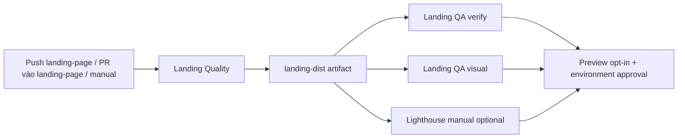

# DeepTrace CI/CD V1

Ngày: 2026-11-05. Workflow: `.github/workflows/landing-ci-cd.yml`.

- Push và PR luôn chạy Quality, functional và visual. Dispatch nhánh khác bị skip. Concurrency hủy run cũ cùng PR/ref.
- Quality chạy typecheck và lint cả `web` + `@workspace/ui`, build riêng web và prerender. Build artifact được chia sẻ giữa các QA jobs, không build lại.
- Composite setup cài Corepack 0.36.0, pnpm 11.25.0 và frozen lockfile, cache pnpm store theo OS và lock/workspace config. Node CI là 22.16.0; root engines tăng lên >=22.13.0 theo metadata pnpm 11.25.0.
- `scripts/ci/run-qa.mjs` dùng Vite preview cổng 4174, xác nhận server công bố địa chỉ và HTTP trả thành công trước khi chạy CJS test hiện có. Server được dừng trong finally; lỗi suite trả exit code khác 0.
- Functional và visual chạy riêng, `fail-fast: false` để giữ chẩn đoán cả hai. Chromium và system dependencies được cài trong Ubuntu runner; scripts thử Chrome channel rồi fallback Chromium.
- Artifacts chỉ gồm dist, JSON, screenshots và logs từ thư mục suite cụ thể, giữ 7 ngày. Không upload workspace hay `.vercel`/`.env`.
- Performance chỉ chạy khi dispatch chọn `performance`; sử dụng script Lighthouse 13.5.0 hiện có, ba mobile và ba desktop, thống kê median/min/max và bundle raw/gzip. Chưa đặt score hard gate. Nếu đã yêu cầu audit và audit lỗi, Preview bị chặn.
- Preview chỉ chạy từ landing-page, không phải PR, flag repo bật, tất cả QA gates đạt và Performance đạt hoặc không được yêu cầu. Token chỉ có ở bước pull/build/deploy, không có ở install hay các job CI.
- Chọn GitHub Actions controlled deployment. CLI build cấu hình Preview rồi deploy prebuilt; không có lệnh production/promotion. Smoke kiểm tra HTTP, title, assets, runtime/console errors, đổi ngôn ngữ sau hydration, anchor và login CTA; URL và SHA được ghi summary khi đạt.

## Bảo mật và ranh giới

`contents: read`, checkout không lưu credentials, không có privileged PR trigger. Tất cả remote actions pin SHA 40 ký tự đã đối chiếu tag upstream ngày khảo sát. Chỉ code trusted đã merge/push vào landing-page được tiếp xúc secret Preview. Cần environment reviewer và branch rule để thực thi ranh giới tổ chức; workflow YAML không tự tạo protection.

Quality/QA fail khiến job Preview skip. Preview deploy thành công nhưng smoke fail vẫn làm job fail; deployment có thể tồn tại nhưng không được coi là nghiệm thu. Không có thao tác production.

## Nguồn xác minh

- [pnpm 11 yêu cầu Node 22](https://pnpm.io/blog/releases/11.0), npm metadata `pnpm@11.25.0` xác nhận `>=22.13`.
- [Vercel CLI đọc VERCEL_TOKEN từ môi trường](https://github.com/vercel/vercel/blob/main/packages/cli/src/index.ts).
- [GitHub Actions security hardening](https://docs.github.com/en/actions/security-for-github-actions/security-guides/security-hardening-for-github-actions).
