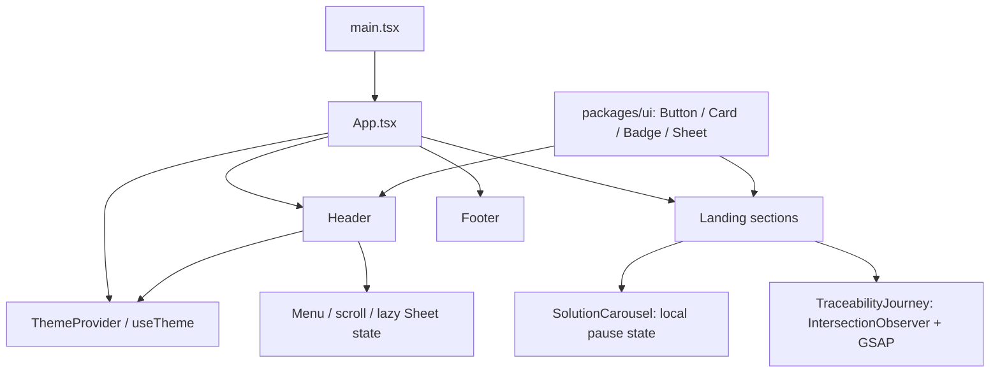

# Báo cáo kiến trúc: module, feature, Zustand, icon và hooks

Ngày khảo sát: 2026-11-05  
Phạm vi: `apps/web/src`, `packages/ui/src`, cấu hình shadcn, manifest và lockfile.  
Mục tiêu: giải thích các khái niệm này đang được áp dụng thế nào trong source hiện tại, phân biệt rõ phần đã có và phần chưa triển khai.

## Kết luận nhanh

| Chủ đề | Hiện trạng trong dự án |
| --- | --- |
| Module/base layer | Chưa có thư mục `modules/` hoặc module nghiệp vụ riêng. `packages/ui` là lớp thư viện giao diện dùng chung gần nhất với nền tảng cơ sở. |
| Feature layer | Chưa có thư mục `features/`. Landing page được tổ chức theo các section trong `apps/web/src/components/landing`. |
| Zustand | Chưa cài và chưa sử dụng. State hiện dùng React `useState` và Context. |
| `lucide-react` | Chưa cài và chưa import trong source. Hai file `components.json` khai báo `iconLibrary: "lucide"`, đây là cấu hình lựa chọn icon cho shadcn CLI, không chứng minh package đã được tích hợp. |
| Hooks | React hooks được dùng trong Header, theme, carousel, hiệu ứng reveal và hành trình. Custom hook hiện có là `useTheme`; thư mục hooks trong shared UI vẫn trống. |

**Đánh giá:** cấu trúc hiện tại phù hợp với một landing page chủ yếu trình bày nội dung và một số tương tác nhỏ. Không nên thêm Zustand hoặc dựng nhiều tầng module chỉ để làm cấu trúc trông phức tạp hơn. Nên thêm các tầng này khi có luồng sản phẩm thực sự cần chúng.

## Cấu trúc hiện tại

```text
apps/web/src/
  App.tsx                         # Ghép trang và bọc ThemeProvider
  main.tsx                        # Khởi chạy React hoặc hydrate nội dung prerender
  components/
    theme-provider.tsx            # Theme state/context và custom hook useTheme
    landing/                      # Header, Hero, các section, Footer, carousel...
  lib/
    motion-tokens.ts              # Tham số chuyển động dùng với GSAP
  styles/
    landing.css                   # Bố cục và giao diện riêng của trang

packages/ui/src/
  components/                     # Button, Badge, Card, Sheet dùng chung
  hooks/.gitkeep                  # Chưa có hook dùng chung
  lib/utils.ts                    # Hàm cn
  styles/globals.css              # Token và utilities giao diện dùng chung
```

Điểm vào trang là `main.tsx`; `App.tsx` bọc ứng dụng bằng `ThemeProvider`, sau đó ghép Header, các section nội dung và Footer theo thứ tự hiển thị. Các component landing hiện là các phần của một trang, không phải những module nghiệp vụ độc lập.

## 1. Module base và feature base

### Module là gì?

Trong cấu trúc ứng dụng theo module, một module gom các phần thuộc cùng một miền nghiệp vụ hoặc khu vực sản phẩm. Module có thể chứa nhiều feature, UI riêng, state và logic của miền đó. Mục tiêu là giúp một nhóm chức năng thay đổi mà không làm các phần khác phụ thuộc lẫn nhau.

Ví dụ khái niệm cho sản phẩm truy xuất nguồn gốc:

- Miền `traceability` có thể gom các luồng liên quan đến hành trình sản phẩm.
- Một feature bên trong có thể là xem hành trình, tra cứu sản phẩm hoặc quản lý thông tin một chặng.

Đây chỉ là ví dụ tổ chức code. Landing page hiện tại không có các màn hình nghiệp vụ hay kết nối API cho những luồng đó; nội dung trong journey và passport là phần trình bày giao diện.

### Feature là gì?

Feature là một khả năng có ý nghĩa với người dùng, thường bao gồm UI, state và quy tắc xử lý cần thiết cho khả năng đó. Feature không nhất thiết là một component đơn lẻ. Một khối tiêu đề, ảnh hoặc section tĩnh thường chỉ là component trình bày.

Trong source hiện tại, `FeaturesSection.tsx` là tên một section trên landing page, không phải thư mục feature theo kiến trúc feature-based. Các component như `Hero.tsx`, `FAQSection.tsx`, `IndustrySolutions.tsx` nằm cùng dưới `components/landing` vì chúng đang tạo thành một trang.

### Dự án hiện có lớp base nào?

`packages/ui` là phần nền dùng chung rõ nhất: Button, Badge, Card và Sheet; cùng utility `cn` và token CSS. `apps/web` dùng chúng qua `@workspace/ui`. Đây là shared UI package, không phải một module nghiệp vụ.

`ThemeProvider`, `motion-tokens.ts` và các component `landing` là phần cấp ứng dụng. Chúng không được tách thành shared package vì hiện chỉ phục vụ trang này.

### Khi nào cần thêm `modules/` hoặc `features/`?

Nên tách khi một capability bắt đầu có nhiều phần liên quan, chẳng hạn nhiều component cùng dùng state, validation, API hoặc các quy tắc xử lý riêng. Khi đó có thể chuyển riêng capability ấy thành vertical slice:

```text
apps/web/src/
  app/                         # Điểm vào, providers, cấu hình ứng dụng
  features/
    product-lookup/
      components/
      hooks/
      model/
      index.ts
  components/landing/          # Các section chỉ phục vụ landing page
  lib/
packages/ui/                   # Primitive giao diện dùng chung giữa workspace
```

Tên và ranh giới feature nên phản ánh luồng người dùng thực tế. Không cần di chuyển toàn bộ section hiện tại chỉ để tạo thư mục `features/`; việc đó tăng số lớp mà chưa tạo ranh giới trách nhiệm có ích.

## 2. Quản lý trạng thái và Zustand

### State hiện đang được giữ ở đâu?

- `Header.tsx`: `useState` giữ menu đóng/mở, trạng thái cuộn, trạng thái tải mobile menu và component Sheet đã tải hay chưa. `useRef` giữ nút menu để trả focus và Promise tải động để tránh bắt đầu cùng một lần tải nhiều lần.
- `SolutionCarousel.tsx`: `useState` giữ trạng thái tạm dừng của carousel. State này chỉ cần trong carousel, nên giữ tại component là hợp lý.
- `theme-provider.tsx`: React Context cung cấp theme toàn ứng dụng. Giá trị theme được khởi tạo từ localStorage hoặc cấu hình mặc định, có hỗ trợ system preference; `useTheme()` đọc context này.
- `TraceabilityJourney.tsx`: GSAP/ScrollTrigger điều khiển hiệu ứng scroll trực tiếp trên panel. Đây là trạng thái animation/DOM, không phải trạng thái nghiệp vụ cần đưa vào store.

### Zustand hiện trạng

Không tìm thấy dependency `zustand` trong `apps/web/package.json`, `packages/ui/package.json` hoặc lockfile, cũng không có store được tạo trong source. Vì vậy không nên gọi cấu trúc hiện tại là đang dùng Zustand.

Zustand là một thư viện store cho React. Nó phù hợp khi nhiều component ở xa nhau cần đọc và cập nhật cùng một client state, hoặc khi việc truyền props/context trở nên khó theo dõi. Store thường gồm state ban đầu và các action để thay đổi state; component chỉ subscribe vào những trường cần dùng.

Với dự án hiện tại, menu và pause state là state cục bộ; theme đã có Context. Chưa có bằng chứng cho thấy cần thêm store toàn cục. Nếu sau này một lựa chọn chặng truy xuất được đồng bộ giữa navigation, nội dung chi tiết và preview sản phẩm, đó mới là ví dụ cần đánh giá store chia sẻ. Không nên đưa trạng thái mở/đóng của một nút vào Zustand nếu chỉ một component dùng.

Ví dụ dưới đây chỉ minh họa cách một store nhỏ có thể trông như thế nào nếu nhiều component thật sự cần dùng chung chặng đang chọn. Đây **không phải source hiện tại**; cần cài `zustand` vào workspace trước khi dùng:

```ts
import { create } from "zustand"

type JourneyState = {
  activeStage: string
  setActiveStage: (stage: string) => void
}

export const useJourneyStore = create<JourneyState>((set) => ({
  activeStage: "origin",
  setActiveStage: (activeStage) => set({ activeStage }),
}))
```

Component chỉ cần chọn giá trị nó dùng: `const activeStage = useJourneyStore((state) => state.activeStage)`. Với state chỉ thuộc một component thì tiếp tục dùng `useState`; với theme hiện tại thì giữ Context là đủ.

## 3. `lucide-react` và icon

Hai file cấu hình shadcn khai báo `"iconLibrary": "lucide"`:

- `apps/web/components.json`
- `packages/ui/components.json`

Nhưng `lucide-react` không có trong dependency và source không import package này. Các icon đang dùng là SVG viết trực tiếp: `ArrowIcon.tsx` được tái sử dụng nhiều nơi; `Header.tsx` có `SunIcon` và `MoonIcon` cục bộ.

Do đó, cấu hình hiện chỉ cho biết lựa chọn icon đã khai báo cho công cụ shadcn. Nó không tự cài package hoặc chuyển các SVG có sẵn sang Lucide. Nếu thêm component từ generator tạo import `lucide-react`, cần cài dependency cho đúng workspace trước khi build.

Một icon library có lợi khi cần nhiều icon đồng bộ, API và kích thước nhất quán. Với vài icon nhỏ hiện có, SVG riêng đang giữ được bundle gọn và kiểm soát hình dạng; đây là trade-off hợp lý. Nếu chuẩn hóa sau này, nên thay theo từng icon có nhu cầu, giữ `aria-hidden` cho icon trang trí và đặt accessible name trên nút chứa icon.

Ví dụ cú pháp khi package đã được cài: `import { ArrowUpRight } from "lucide-react"`. Câu lệnh này hiện chưa dùng được trong source cho tới khi dependency được thêm.

## 4. Hooks trong source

React hook là API như `useState`, `useEffect`, `useRef`, `useContext` để component sử dụng state, lifecycle và context. Custom hook là hàm do dự án viết, bắt đầu bằng `use`, có thể kết hợp các hook khác để tái sử dụng một hành vi.

| Hook | Nơi dùng | Vai trò |
| --- | --- | --- |
| `useState` | Header, SolutionCarousel, ThemeProvider | State giao diện cần làm component render lại khi thay đổi. |
| `useEffect` | Header, Reveal, TraceabilityJourney, ThemeProvider | Đăng ký listener/observer hoặc khởi tạo animation sau khi render; cleanup khi dependency đổi hoặc component unmount. |
| `useRef` | Header, Reveal, TraceabilityJourney, ThemeProvider | Giữ phần tử DOM hoặc giá trị mutable không cần kích hoạt render. |
| `useCallback` và `useMemo` | ThemeProvider | Giữ ổn định callback và object context theo dependency. |
| `useContext` | `useTheme()` | Lấy state theme từ Provider và báo lỗi rõ nếu gọi ngoài Provider. |
| `useTheme` | Header/ThemeToggle | Custom hook của dự án, bọc việc đọc Theme Context. |

`Reveal` dùng `useRef` để lấy phần tử và `useEffect` để đăng ký nó với một `IntersectionObserver` dùng chung; effect cleanup gọi `unobserve`. `TraceabilityJourney` dùng `useEffect` để chỉ tải GSAP sau khi section gần viewport và dọn observer/animation khi rời component. Đây là những ví dụ về hook phối hợp với API trình duyệt và cleanup.

Hiện chưa có `apps/web/src/hooks` và `packages/ui/src/hooks` chỉ có `.gitkeep`. Vì vậy custom hook `useTheme` đang đặt cùng file với provider; không có thư viện hook dùng chung riêng. Nếu có thêm hook, hãy đặt ở gần feature trước; chỉ chuyển sang shared hooks khi nhiều feature dùng chung hành vi đó.

### Quy tắc cần nhớ khi viết hook

1. Gọi hook ở đầu component hoặc custom hook, không gọi bên trong `if`, vòng lặp hay callback.
2. Với `useEffect`, khai báo đủ dependency và trả cleanup cho listener, observer, timer hoặc animation cần giải phóng.
3. Dùng `useState` cho dữ liệu làm thay đổi giao diện; dùng `useRef` cho DOM hoặc dữ liệu mutable không cần render lại.
4. Custom hook nên biểu đạt một hành vi có thể tái sử dụng, ví dụ `useTheme`; không cần biến mọi vài dòng code thành hook.

## 5. Sơ đồ luồng hiện tại



## Khuyến nghị

1. Giữ `packages/ui` làm nơi cho primitive giao diện dùng chung; giữ các section thuần landing trong `components/landing`.
2. Chưa cần cài Zustand cho state hiện có. Đánh giá lại khi một client state thực sự cần chia sẻ giữa nhiều khu vực độc lập.
3. Cấu hình Lucide và dependency hiện chưa khớp: nếu nhóm muốn dùng Lucide cho icon mới, thêm `lucide-react` vào workspace `web` rồi chuẩn hóa dần; nếu tiếp tục dùng SVG riêng, ghi nhận cấu hình CLI chỉ là tùy chọn generator.
4. Tạo thư mục hooks khi có custom hook thứ hai hoặc khi một hành vi được nhiều feature tái sử dụng; đặt hook theo feature trước, tránh tạo thư mục rỗng làm người đọc nghĩ đã có layer.
5. Chỉ thêm cấu trúc `modules/features` khi có capability nghiệp vụ độc lập với nhiều logic và state. Landing tĩnh hiện tại chưa cần tổ chức lại toàn bộ.

## Giới hạn khảo sát

Đây là báo cáo đọc source và cấu hình hiện tại. Không thêm dependency, không chuyển cấu trúc thư mục và không thay đổi hành vi ứng dụng. Kết luận về thư viện dựa trên manifest, lockfile và import trong các workspace đã rà soát.
